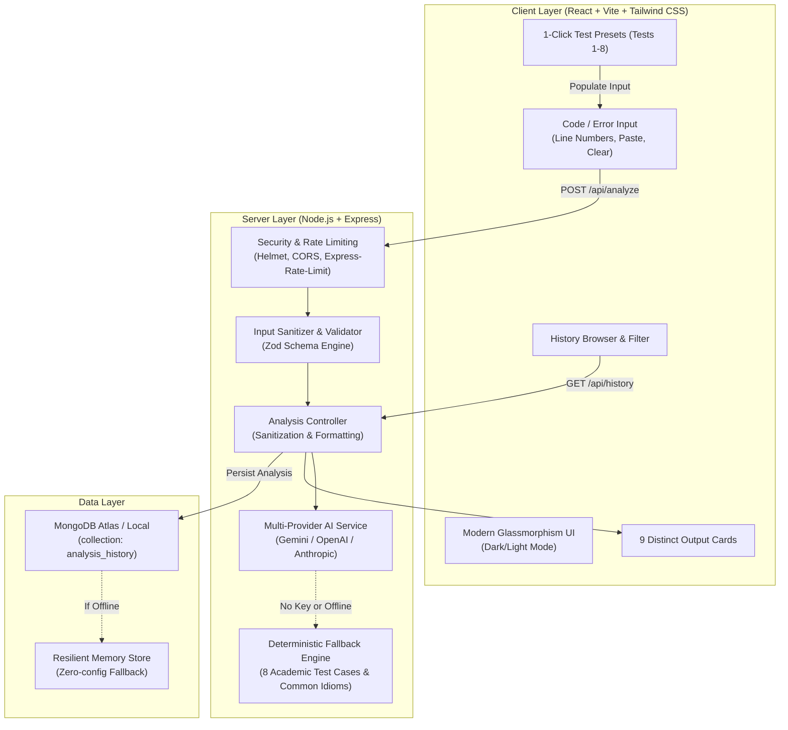

# AI-03 — AI Code Explanation Assistant
> **Understand. Fix. Improve. Learn.**  
> A professional, AI-powered web platform tailored for beginner and intermediate programmers to demystify complex source code, diagnose errors, repair bugs, optimize execution, and cultivate best coding practices through structured pedagogical breakdowns.

---

## 1. Project Overview

The **AI Code Explanation Assistant** is a full-stack, enterprise-grade educational developer tool. When programmers encounter cryptic compiler errors, unfamiliar syntax, suboptimal algorithms, or subtle logic defects, generic LLM responses often overwhelm beginners with dense jargon or under-explain mechanics to intermediate learners.

This platform bridges that gap by providing **adaptive, structured explanations** across two distinct learning tiers (**Beginner** and **Intermediate**) and 5 functional action modes (**Explain Code**, **Explain Error**, **Fix Code**, **Optimize Code**, and **Explain + Fix**) across 8 major programming languages.

---

## 2. Problem Statement

Beginner and intermediate programmers routinely struggle with:
1. **Cryptic Error Messages**: Compilers and interpreters emit terse tokens (e.g., `SyntaxError: unexpected EOF while parsing`, `ReferenceError: name is not defined`, `expected ';' before 'return'`) without explaining *why* they happened or how to prevent them.
2. **Generic AI Answers**: Chatbots frequently output unformatted paragraphs, hallucinate non-existent issues, or fail to tailor explanations to the student's actual knowledge level.
3. **Unstructured Feedback**: Developers need clear separation between the problem diagnosis, root cause, suggested remedy, corrected code, expected output, and algorithmic complexity.
4. **Poor Iteration Practices**: Novices often rely on anti-patterns (such as index loops instead of iterables) without understanding performance implications.

---

## 3. Objectives

- **Demystify Programming Errors**: Translate raw runtime/syntax stack traces into plain English explanations.
- **Adaptive Depth**: Deliver line-by-line concept breakdowns for beginners, and AST/token/complexity analysis for intermediate engineers.
- **Fixed Structured Output**: Enforce a strict JSON contract guaranteeing 9 discrete diagnostic output cards.
- **Support Multi-Language Workflows**: Seamlessly analyze Python, JavaScript, Java, C++, C, HTML, CSS, and SQL.
- **Provide Actionable Fixes**: Supply corrected code with syntax highlighting, 1-click clipboard copying, and verified sample outputs.
- **Zero-Friction Academic Demonstration**: Include instant 1-click test case presets, a resilient offline fallback knowledge engine, and persistent analysis history.

---

## 4. Key Features

- **Large Code/Error Editor**: Includes dynamic line numbers, character counts, auto-resize, syntax styling, clipboard paste, and keyboard shortcuts (`Ctrl+Enter` to analyze).
- **8 Supported Programming Languages**:
  - Python (`.py`)
  - JavaScript (`.js`)
  - Java (`.java`)
  - C++ (`.cpp`)
  - C (`.c`)
  - HTML (`.html`)
  - CSS (`.css`)
  - SQL (`.sql`)
- **Dual Adaptive Difficulty Tiers**:
  - **Beginner**: High-clarity language, avoidance of intimidating terminology, line-by-line breakdown, core programming concepts, and illustrative examples.
  - **Intermediate**: In-depth compiler/interpreter rationale, LEGB scope resolution, AST grammar rules, time/space complexity analysis ($O(1)$, $O(N)$), edge cases, and optimization.
- **5 Focused Analysis Modes**:
  1. `Explain Code`: Step-by-step logic breakdown.
  2. `Explain Error`: Root-cause diagnosis of runtime and syntax error traces.
  3. `Fix Code`: Direct bug repair with corrected source code.
  4. `Optimize Code`: Refactoring anti-patterns into performant, idiomatic constructs.
  5. `Explain + Fix`: Comprehensive end-to-end diagnostic, repair, and educational lesson.
- **Strict 9-Card Glassmorphism Result Dashboard**:
  - **Card 1: Code / Error Summary** — High-level overview of the submission.
  - **Card 2: Identified Issue** — Precise pinpointing of the bug or anti-pattern.
  - **Card 3: Why This Happens** — Fundamental explanation of compiler/grammar rules.
  - **Card 4: Suggested Solution** — Clear actionable remedy.
  - **Card 5: Corrected Code** — Syntax-highlighted code with 1-click "Copy Code" button.
  - **Card 6: Example Output** — Terminal display of predictable standard output.
  - **Card 7: Detailed Explanation** — Line-by-line breakdown calibrated to difficulty level.
  - **Card 8: Best Practices** — Professional engineering guidelines to prevent recurrence.
  - **Card 9: Complexity Analysis** — Big-O time and space complexity evaluations.
- **Instant Test Case Presets**: 1-click buttons to load and verify the 8 specification test cases.
- **Analysis History & Persistence**: Saves past analyses to MongoDB (with automatic local/memory fallback), filterable by language and difficulty, with instant "Load in Analyzer" reload.
- **Dark/Light Theme**: Sleek glowing AI blue/purple cyber aesthetic with glassmorphism backdrop blurs.

---

## 5. System Architecture



---

## 6. Technologies Used

### Frontend
- **React 18** (Component-driven UI library)
- **Vite 5** (Ultra-fast build tool and development server)
- **Tailwind CSS 3** (Utility-first styling with custom glassmorphism and glowing gradients)
- **Lucide React** (Clean, modern icon library)
- **Prism.js** (Syntax highlighting for Python, JS, C, C++, Java, SQL, HTML, CSS)

### Backend
- **Node.js** (v20+ / v24+ runtime)
- **Express.js 4** (Lightweight, robust web framework)
- **Helmet** (HTTP security headers)
- **CORS** (Configurable Cross-Origin Resource Sharing)
- **express-rate-limit** (DDoS and brute-force protection)
- **Zod** (Strict schema validation for inputs and responses)
- **Mongoose 8** (MongoDB ODM with automated graceful degradation)

### AI Model Integration
- **Google Gemini API** (`gemini-2.0-flash`, `gemini-1.5-flash`) via `@google/generative-ai`
- **OpenAI API** (`gpt-4o-mini`, `gpt-4o`)
- **Anthropic Claude API** (`claude-3-5-sonnet`)
- **Smart Knowledge Engine** (Deterministic fallback for all 8 test cases and common patterns)

### Testing
- **Jest 29** & **Supertest 7** (Automated backend unit, integration, and specification tests)

---

## 7. Installation

### Prerequisites
- Node.js (v18.0.0 or higher, tested on Node v24.16.0)
- npm (v9.0.0 or higher)
- Optional: MongoDB running locally or a MongoDB Atlas connection string

### Clone & Install
```bash
# Navigate to the project root
cd "d:/AI PROJECT"

# Install backend dependencies
cd backend
npm install

# Install frontend dependencies
cd ../frontend
npm install
```

---

## 8. Environment Variables

### Backend Configuration (`backend/.env`)
Create a `.env` file in the `backend/` directory:

```env
PORT=5000
NODE_ENV=development
FRONTEND_URL=http://localhost:5173

# AI Provider Configuration (gemini, openai, or anthropic)
AI_PROVIDER=gemini

# Primary AI Key
AI_API_KEY=your_gemini_or_openai_api_key_here

# Specific Provider Keys (Optional overrides)
GEMINI_API_KEY=
OPENAI_API_KEY=
ANTHROPIC_API_KEY=

# MongoDB URI (Optional: system automatically falls back if offline)
MONGODB_URI=mongodb://localhost:27017/ai_code_assistant
```

> **Note**: If `AI_API_KEY` is not set or during offline evaluations, the system automatically engages its built-in **Smart Knowledge Fallback Engine**, ensuring that all 8 test cases and common code analyses execute reliably without failure.

### Frontend Configuration (`frontend/.env`)
Create a `.env` file in the `frontend/` directory (optional in development due to Vite proxy):

```env
# Leave blank for local development to use Vite's built-in proxy (/api -> http://localhost:5000)
VITE_API_URL=
```

---

## 9. How to Run Frontend

```bash
cd frontend
npm run dev
```

The frontend application will start on **`http://localhost:5173`**.

---

## 10. How to Run Backend

```bash
cd backend
npm run dev
# or for production:
npm start
```

The backend server will start on **`http://localhost:5000`**.

---

## 11. API Documentation

### 1. Code Analysis
**`POST /api/analyze`**

**Headers:** `Content-Type: application/json`

**Request Body:**
```json
{
  "language": "Python",
  "difficulty": "beginner",
  "analysisType": "explain-fix",
  "code": "print(\"Hello\""
}
```

**Response (200 OK):**
```json
{
  "success": true,
  "analysisId": "65f01234...",
  "result": {
    "summary": "The program contains a syntax error because the closing parenthesis is missing.",
    "identified_issue": "Missing ')' after the print statement.",
    "why_it_happens": "Python requires every opening parenthesis '(' to have a matching closing parenthesis ')'.",
    "suggested_solution": "Add the missing closing parenthesis ')' at the end of the print statement.",
    "difficulty": "beginner",
    "line_by_line_explanation": [
      "Line 1: print(\"Hello\" — Starts printing the text 'Hello', but misses the closing ')'."
    ],
    "corrected_code": "print(\"Hello\")",
    "example_output": "Hello",
    "best_practices": [
      "Always match opening and closing brackets.",
      "Use an IDE/editor with syntax highlighting.",
      "Run small pieces of code while debugging."
    ],
    "complexity": "Time Complexity: O(1) | Space Complexity: O(1)"
  }
}
```

---

### 2. Analysis History
**`GET /api/history?limit=20&language=Python&difficulty=beginner`**

**Response (200 OK):**
```json
{
  "success": true,
  "count": 5,
  "history": [
    {
      "_id": "...",
      "user_id": "anonymous_user",
      "language": "Python",
      "difficulty": "beginner",
      "analysis_type": "explain-fix",
      "original_code": "print(\"Hello\"",
      "identified_issue": "Missing ')' after the print statement.",
      "corrected_code": "print(\"Hello\")",
      "created_at": "2026-10-01T12:00:00.000Z"
    }
  ]
}
```

---

### 3. Health Check
**`GET /api/health`**

**Response (200 OK):**
```json
{
  "status": "ok",
  "service": "AI Code Explanation Assistant API",
  "timestamp": "2026-10-01T12:00:00.000Z"
}
```

---

## 12. Testing

The backend includes a comprehensive Jest and Supertest automated test suite covering all 8 specification test cases:

```bash
cd backend
npm test
```

### Verified Test Cases:
| Test ID | Test Scenario | Input Code | Expected Output Verification |
|---|---|---|---|
| **TEST 1** | Python syntax error | `print("Hello"` | Detects missing closing parenthesis; returns `print("Hello")`. |
| **TEST 2** | Python NameError | `print(x)` | Explains variable `x` is not defined before use. |
| **TEST 3** | Correct Python code | `name = "Sri"\nprint(name)` | Validates code is correct and produces `"Sri"`. |
| **TEST 4** | JavaScript error | `console.log(name);` | Diagnoses undeclared variable / ReferenceError / scoping. |
| **TEST 5** | C++ syntax error | `#include <iostream>... cout << "Hello" return 0;` | Identifies missing semicolon `;` after cout statement. |
| **TEST 6** | Difficulty comparison | `print("Hello"` at Beginner vs Intermediate | Verifies different explanation depth (AST/tokens vs plain terms). |
| **TEST 7** | Optimization | `for i in range(len(numbers)): print(numbers[i])` | Suggests Pythonic direct iteration: `for number in numbers:`. |
| **TEST 8** | Logical error | `a = 10; b = 20; if a > b: print("a is smaller")` | Pinpoints contradiction between operator `>` and message. |

---

## 13. Deployment

### Frontend Deployment (Vercel)
1. Push code to your GitHub repository.
2. Link the repository on [Vercel](https://vercel.com).
3. Set the **Root Directory** to `frontend`.
4. Configure Build Command: `npm run build` and Output Directory: `dist`.
5. Add Environment Variable:
   - `VITE_API_URL`: `https://your-backend-api.onrender.com`
6. Click **Deploy**.

### Backend Deployment (Render / Railway)
1. Create a **Web Service** on [Render](https://render.com) or [Railway](https://railway.app).
2. Set the **Root Directory** to `backend`.
3. Set Build Command: `npm install`
4. Set Start Command: `npm start`
5. Configure Environment Variables:
   - `PORT`: `5000`
   - `NODE_ENV`: `production`
   - `FRONTEND_URL`: `https://your-frontend.vercel.app`
   - `AI_PROVIDER`: `gemini`
   - `AI_API_KEY`: `your_production_gemini_or_openai_key`
   - `MONGODB_URI`: `your_mongodb_atlas_connection_string`

### Database (MongoDB Atlas)
1. Create a free cluster on [MongoDB Atlas](https://www.mongodb.com/cloud/atlas).
2. Create a database user and whitelist `0.0.0.0/0` (or your backend provider IP).
3. Paste the connection string into the backend `MONGODB_URI` environment variable.

---

## 14. Future Enhancements

1. **Multi-File Workspace Analysis**: Uploading entire repositories or multiple modules to explain cross-file imports and dependencies.
2. **Interactive In-Browser Code Sandbox**: WebAssembly (Pyodide for Python, WebContainer for Node) to execute and test the corrected code live directly in the browser.
3. **Voice Explanations**: Text-to-speech integration enabling beginners to listen to spoken step-by-step code walkthroughs.
4. **Git Diff Viewer**: Side-by-side visual diff comparisons between submitted code and corrected code.
5. **Personalized Learning Quizzes**: Automatically generating 3 multiple-choice questions after each fix to test student comprehension.
